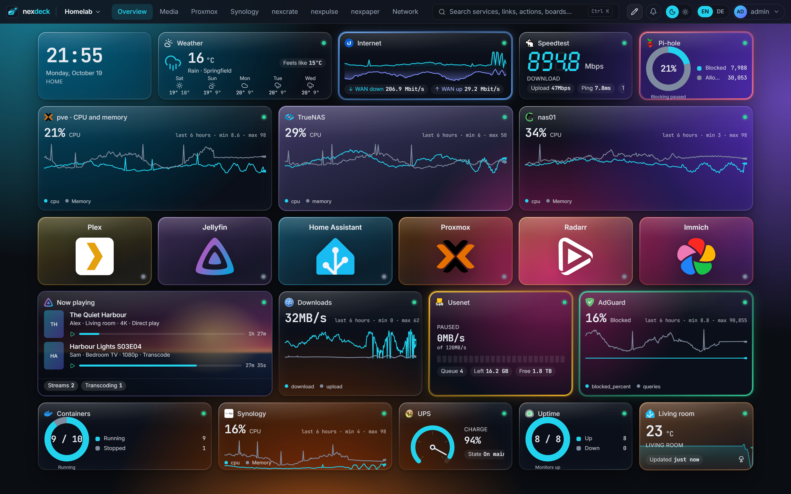
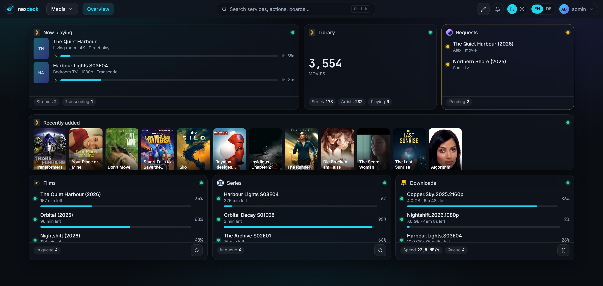
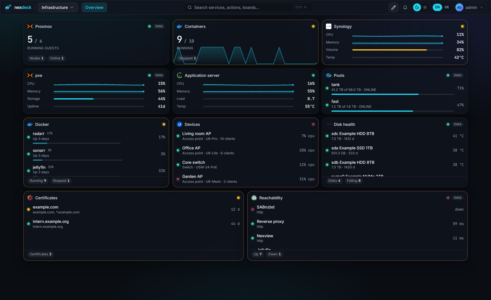
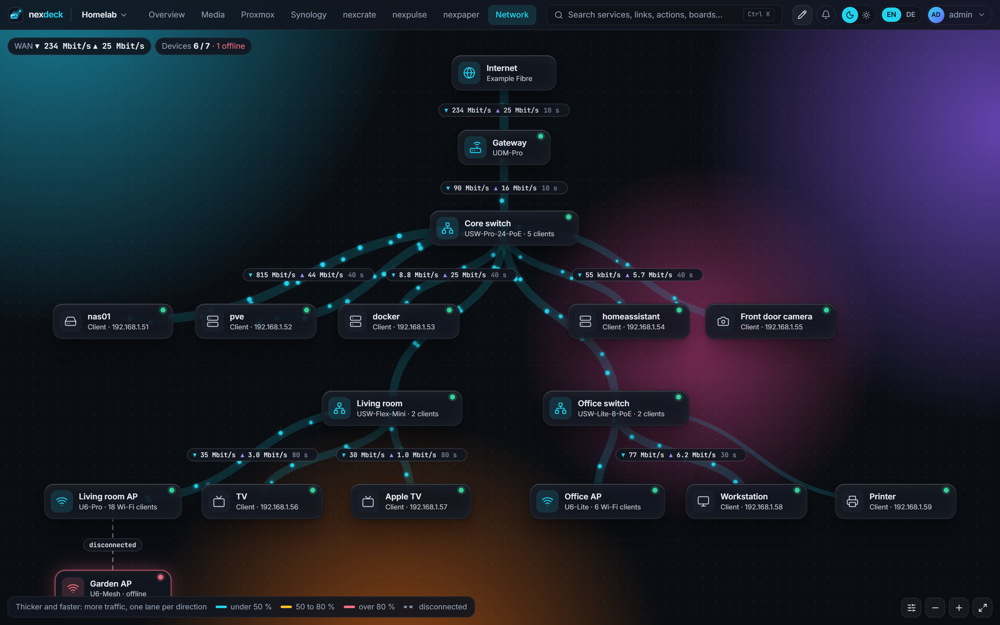
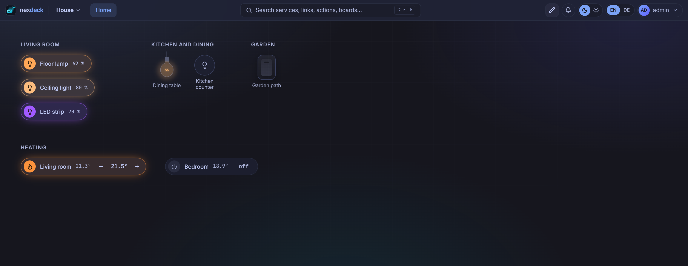
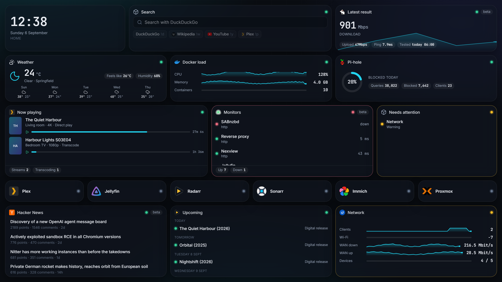

# nexdeck

**The live homelab dashboard.** Cards that move, actions on the cards, boards for the desk, the phone and the wall.

nexdeck belongs to the nexapps family, next to [Nexview](https://github.com/DerKezorm/nexview), [nexcrate](https://github.com/DerKezorm/nexcrate), [nexpaper](https://github.com/DerKezorm/nexpaper), [nexmail](https://github.com/DerKezorm/nexmail), [nexpulse](https://github.com/DerKezorm/nexpulse) and more. Every one of them has cards on the board.

[](https://github.com/DerKezorm/nexdeck/actions/workflows/ci.yml)
[](https://github.com/DerKezorm/nexdeck/pkgs/container/nexdeck)
[](LICENSE)
[](#the-services-it-speaks-to)



## What it does

- **Live, not polled by your browser.** The server asks every service in its own rhythm and pushes changes to every open browser. Ten tabs cost a service one request.
- **176 integrations,** listed in full [further down](#the-services-it-speaks-to). Generic building blocks for everything else: a JSON API widget, a calendar that merges several sources, iframes, notes and bookmarks.
- **A map of your network.** A page can be a live plan of your UniFi network: gateway, switches and access points as a tree, each on the port it hangs from, with the traffic of every link running in both directions. You pick which servers and devices join it, and nothing moves by itself.
- **Your home, switched from the board.** A page can hold the lamps, thermostats, covers, scenes, switches, sensors and statistics of Home Assistant on a free surface, as small as a light switch, each in a style of its own, from a pill to a rocker switch, a dial, a window or a door. nexdeck calls nothing but their own services, and only for what stands on the page. A beta for now.
- **Actions where the data is.** Restart a container, start a VM, pause downloads, approve a request, wake a machine, flip a light. Destructive actions confirm once. Everything is logged.
- **Three screens.** A free grid of 12, 24 or 36 columns you arrange once: a tablet shows it as arranged, a phone stacks the cards in the same order. Drag cards into a group, where each takes a width and a height of its own, or into a side bar that stays in place while the page scrolls. An installable phone app with a bottom bar, kiosk links for wall tablets that cycle pages and dim at night, and a sign-in without a password for a tablet on the home network.
- **Yours to look at.** Your own name and logo in the browser tab, the bar, on the sign-in page and on the installed app. Thirteen colour themes besides nexdeck's own, Catppuccin, Nord, Dracula, Tokyo Night, Gruvbox and Rosé Pine among them, cards drawn as glass, liquid glass with an edge that bends the light, flat, outline or with a neon edge, each card in a colour of its own if you like, and backgrounds that drift, show the stars or follow the time of day. Numbers roll to each new reading, and a card that goes down glows red while the room behind it turns a little red too.
- **For the wall.** Key figures put numbers from several services into one grid of tiles that grow with the card and turn yellow or red. A countdown to a date, and a kitchen timer that rings and flashes when it is done.
- **Made to be shown.** Showcase mode replaces addresses, host names, people, devices and appointments with made-up ones that read like real ones, and a board saves as a picture on a frame of colour, ready for a forum or a chat.
- **Users, roles and sharing.** Administrators, users and guests. Boards are private, shared with people or with a whole role, at view, edit or act level.
- **What changed, and since when.** A chronicle of every card that turned yellow or red, every outage, new version and restarted container, and what was changed in nexdeck. A card that needs a look says since when, one card gathers everything that does, a daily report sums up the day, and maintenance keeps a planned restart quiet.
- **Ask nexdeck.** A chat for administrators that answers from the cards, the chronicle and the history, and shows a button with what it would hit instead of pressing it. Claude, or a model on your own network such as Ollama; off until you choose one.
- **What runs on what, and why it broke.** nexdeck learns which service runs in which container on which machine, from Docker, Portainer, a Synology, Proxmox and Nginx Proxy Manager. A host that goes down is one message naming what it took with it, and a red card's "Why?" opens a page with since when, what happened before, the container's log on asking and a runbook of your own.
- **History over months.** Every number kept as hours for 90 days and days for two years, charts over a year, and a forecast of when a volume is full.
- **Reachability and notifications.** App tiles carry a check with uptime bars; outages reach you through Telegram, e-mail, Web Push, ntfy, Gotify, Discord, Slack or Apprise.
- **What is out of date.** Every connection shows the version its service runs, and once you let nexdeck ask GitHub, the Updates card lists the services behind their project's newest release, next to containers from What's Up Docker, Cup, Arcane and Dockhand.
- **A head start.** Six board templates that fill their slots with whichever of your services fits, and an import from Homepage or Homarr that shows its plan before it makes anything.
- **Boards as files.** Export a board as YAML, keep it in Git, drop it into `data/boards/` to provision it. Docker labels create tiles.
- **Sign in your way.** Local accounts, OpenID Connect with several providers side by side (authentik in one step, Microsoft Entra ID, Keycloak, Authelia, Pocket ID and friends), personal API tokens.
- **In English, German, Spanish, French or Italian.** The interface and every card, including what the services report. Each account picks the two languages that stand in its top bar.

## A board is whatever you put on it

Every card is a widget of one integration, dropped on a free grid and sized by hand. A template is only where you begin.

### Media

What is playing, what the library holds, what is on its way in, and the covers of what arrived last. And your own music: a player card plays the library of Plex, Jellyfin or Emby in the browser, keeps playing from board to board, and edits playlists on the server.



### Infrastructure

The same grid, a different question. Hosts, containers, pools, disks, certificates and what answers.



### Your network

A page of its own kind: the plan of a UniFi network, read from the console you already connected. Each link carries its traffic as dots or dashes in both directions, coloured by load, with the age of the value beside it. Click a device to light up its way to the internet and see its ports. Servers, the NAS and other wired devices join from a list; whatever the console finds later waits under Found until you place it. On a phone the plan becomes an indented list. UniFi only for now; SNMP is next.



### Your home

A third kind of page, for Home Assistant and a beta for now: the controls of your home on a free surface instead of the card grid, so a light switch takes the room of a light switch. Put headings over your rooms, place everything where you like it, and grow or shrink a drawing by its corner. Pick from lists that leave out what does not belong on a wall (settings, diagnostics, anything hidden in Home Assistant):

- **Lamps** in ten styles: pill, round, chip, tile, slider, ring, rocker, dots, bulb or knob, mixed as you like. A tap switches a lamp, a drag sideways dims it, and holding it opens its brightness, white and colour, as far as the lamp has them.
- **Thermostats** in ten styles of their own (pill, round, chip, tile, slider, dial, valve head, thermometer, radiator or big digits), showing the room as read by the thermostat or by a temperature sensor you choose. Swipe one sideways to set the target, or turn the dial and the valve head; it stays in the thermostat's own steps and bounds and is sent once you let go. A tap opens its mode, presets and recent history.
- **Covers** as a pill, chip, tile, window, slider or slats: open, close, stop and a position, and the slats where the cover has them. Several covers make one card, with positions of your own such as Morning or Night.
- **Scenes and scripts** as a pill or a tile, or several as a bar or a grid. A scene says when it last ran, a script whether it is running.
- **Switches**, plugs among them, as a pill, outlet, rocker, toggle, chip or tile, with what the device draws when it has a power sensor. A switch can ask before it turns off, and several make one card with their total.
- **Sensors**: doors and windows (pill, chip, tile, window or door, or many on one card or a house), temperature and humidity (pill, tile, thermometer or ring, or the rooms in a list), and a card of hints such as a window open in a room being heated or humidity from 65 %.
- **Statistics** from Home Assistant's long-term statistics, as a line, rooms, a band, bars, small or a comparison, over 24 hours, 7 or 30 days, with now, low, high and mean.

Every element can carry a name of its own, keeps its place when it is renamed in Home Assistant, and follows the card style under Appearance, liquid glass and tilt included. On a phone every heading keeps its elements under it, and on a wall display the page switches when its kiosk link allows actions. The lists are read from Home Assistant's registry, which it shows only to an administrator, so the connection needs a long-lived token of one.



### On the wall

A kiosk link opens one board without a sign-in, read-only unless you say otherwise. It cycles through the pages and dims at night. The token is handed in once at the door and never rides in an address afterwards.



## Quick start

```bash
mkdir nexdeck && cd nexdeck
curl -fsSL https://raw.githubusercontent.com/DerKezorm/nexdeck/main/docker-compose.yml -o docker-compose.yml
docker compose up -d
```

Open `http://your-host:5175`. The first start creates the administrator and offers a demo board with invented, moving data, so you can look around before connecting anything.

Mount `/var/run/docker.sock` (already in the compose file) to see this host's containers, act on them and follow their logs. On Synology the same socket serves Container Manager.

### Configuration

| Variable | Default | Purpose |
|---|---|---|
| `NEXDECK_SECRET_KEY` | generated into `/data/secret.key` | Encrypts stored API keys and signs sessions. Set it once and keep it. |
| `NEXDECK_PUBLIC_URL` | empty | How browsers reach nexdeck. Needed for OpenID Connect and Web Push. |
| `NEXDECK_DEMO` | `0` | Start every widget with invented data. |
| `NEXDECK_LOG_LEVEL` | `INFO` | `DEBUG` logs every adapter request. |
| `NEXDECK_ALLOW_LOOPBACK_TARGETS` | `0` | Let notification channels, Web Push, RSS cards and reachability checks call `127.0.0.1`. Connections an administrator made are never affected. |
| `NEXDECK_UPLOAD_QUOTA_MB` | `200` | What one account may leave lying in `/data/uploads`. `0` means no ceiling. |
| `NEXDECK_KEEP_ACTION_LOG_DAYS` | `90` | How long the record of who pressed what is kept. `0` keeps it forever. |
| `NEXDECK_KEEP_NOTICES_DAYS` | `90` | How long messages in the notice centre are kept. |
| `NEXDECK_KEEP_OUTAGES_DAYS` | `365` | How long finished outages are kept, and maintenance that is over. A running one is never swept. |
| `NEXDECK_KEEP_EVENTS_DAYS` | `365` | How long the lines of the chronicle are kept. |
| `PUID`, `PGID` | `1000` | Owner of the files in the data volume. |
| `DOCKER_GID` | detected | Group of the mounted Docker socket, when detection fails. |

Rarely needed, but real:

| Variable | Default | Purpose |
|---|---|---|
| `NEXDECK_DATA_DIR` | `/data` | Where the database, the key file, uploads and caches live. |
| `NEXDECK_STATIC_DIR` | set in the image | The built frontend. Empty means the API only. |
| `NEXDECK_COOKIE_SECURE` | `auto` | `auto` sets the Secure flag when the request came over HTTPS, directly or from a proxy named in `NEXDECK_TRUSTED_PROXIES`; `always` and `never` force it. |
| `NEXDECK_SESSION_DAYS` | `30` | Days a browser stays signed in without activity. |
| `NEXDECK_BCRYPT_ROUNDS` | `12` | Cost of a password hash. Lower is faster and weaker. |
| `NEXDECK_DB_POOL_SIZE` | `20` | Database connections held open. |
| `NEXDECK_DB_MAX_OVERFLOW` | `20` | How many more may be opened under load. |
| `NEXDECK_REQUEST_THREADS` | `24` | Worker threads for synchronous routes. Keep it below the two above added together. |
| `NEXDECK_HISTORY_RAW_HOURS` | `1` | How long raw samples are kept before they become minute averages. |
| `NEXDECK_HISTORY_MINUTE_HOURS` | `24` | How long those minute averages are kept. |
| `NEXDECK_HISTORY_HOUR_DAYS` | `90` | How long hour averages are kept, with their lowest and highest: charts of 7 and 30 days and the forecasts read them. |
| `NEXDECK_HISTORY_DAY_DAYS` | `730` | How long day averages are kept: a chart of a year. |
| `NEXDECK_LOG_HISTORY_HOURS` | `6` | How long container log lines are kept. |
| `NEXDECK_HEALTH_INTERVAL_SECONDS` | `30` | Default interval for reachability checks. |
| `NEXDECK_OUTAGE_THRESHOLD_SECONDS` | `120` | How long a service must be down before an outage is announced. |
| `NEXDECK_ICON_CACHE_DAYS` | `30` | How long a fetched logo is kept. |
| `NEXDECK_UPDATE_CHECK` | `0` | Ask GitHub whether a newer nexdeck exists, and for the newest releases of the connected services. Off by default: it is an outbound call, and the projects asked about tell GitHub which services run here. Also under System, About. |
| `NEXDECK_CORS_ORIGINS` | empty | Origins allowed to call the API from a browser. `*` is refused at start-up, because with credentials it would let any site act as the signed-in user. |
| `NEXDECK_BACKUP_EVERY_HOURS` | `24` | How often a snapshot is written by itself. `0` switches it off. |
| `NEXDECK_TRUSTED_PROXIES` | empty | Addresses or networks of the reverse proxies in front of nexdeck, comma separated. Their `X-Forwarded-For` is believed when nexdeck decides whether a browser is on the home network; without it, a forwarded request is never signed in automatically. It is also the only list whose `X-Forwarded-Proto` is believed for the Secure flag of cookies and whose `X-Forwarded-Proto` and `X-Forwarded-Host` the sign-in believes for its redirect address; empty, nobody's is (see below). |

A guard test keeps this table in step with the settings in the code.

### Reverse proxy

nexdeck speaks plain HTTP on port 8000. It believes `X-Forwarded-Proto` only from a proxy named in `NEXDECK_TRUSTED_PROXIES`, and out of the box from nobody: then the scheme is the one the request really came in on, so a visitor cannot choose it. Of a named proxy the right-most value of the last header line counts (the one the nearest proxy wrote), `http` or `https` in any case. That scheme decides the `Secure` flag of the cookies. **Behind a proxy that ends TLS, name it in `NEXDECK_TRUSTED_PROXIES`, or set `NEXDECK_COOKIE_SECURE=always`**; otherwise the cookies go without the Secure flag (until 0.39.0 every sender's header was believed for it). The redirect address the sign-in sends to a provider: with a public address set (System → Sign-in) that address is used and no header is read; without one, scheme and host come from `X-Forwarded-Proto` and `X-Forwarded-Host` by the same rule, so a visitor cannot make the sign-in send a provider an address of their choosing. Without a named proxy the sign-in uses the address the request really came in on. This is the setting the authentik card means when it warns that the server sees a request as `http`: name your proxy, or set the public address. Server-Sent Events need a proxy that does not buffer: for nginx, `proxy_buffering off;` on the location; Traefik and Caddy need nothing.

### Sign-in providers

Under System → Sign-in an administrator adds OpenID Connect providers (each gets a button on the sign-in page, in the order of the list), sets authentik up in one step with a one-time API token, or downloads a blueprint instead. Microsoft Entra ID takes `https://login.microsoftonline.com/common/v2.0` (or `organizations`, or a tenant) as the issuer. A provider's redirect address is `<public address>/api/v1/oidc/<short name>/callback`; providers set up with nexdeck 0.36 or older keep `/api/v1/auth/oidc/<short name>/callback`, which their provider already knows. Accounts are found by the provider's subject only, never by an e-mail address; people link their own account under Profile, with their password. Password sign-in can be switched off once a provider is active; administrators can always use their password.

Signing in on the home network (System → Home network) needs the browser's real address. Behind a proxy, name the proxy in `NEXDECK_TRUSTED_PROXIES`; the page shows what nexdeck makes of your own address. The image starts uvicorn with `--no-proxy-headers` and reads the forwarding headers itself; a compose file that overrides the command should do the same.

## The services it speaks to

**Hosts and containers.** Docker, Proxmox VE, Proxmox Backup Server, Kopia, Duplicati, Portainer, Nomad, Cup, Coolify, Gitea, Forgejo, GitLab, Semaphore UI, Meilisearch, Synology DSM, Unraid, TrueNAS, openmediavault, Glances, Beszel, Prometheus, Alertmanager, Grafana, Scrutiny, UPS through PeaNUT, Wake-on-LAN, Backrest, Komodo, Arcane, Dockhand, Kubernetes, UrBackup, Elasticsearch and OpenSearch, Netdata, Pulse, Ollama, Garage, Open WebUI, Watchtower, What's Up Docker, Zabbix, nextrmnl, PatchMon.

**Network.** Public IP address, Cloudflare, UniFi, MikroTik, SNMP (switches and network devices), FRITZ!Box, OPNsense, pfSense, FortiGate, OpenWrt, Traefik, Caddy, Nginx Proxy Manager, nginx ignition, Pi-hole, AdGuard Home, Technitium, NextDNS, Tailscale, Headscale, NetBird, Pangolin, wg-easy, NetBox, Gluetun, authentik, CrowdSec, Shlink, Speedtest Tracker, nexpulse, nexsift, Uptime Kuma, Healthchecks, ChangeDetection.io, n8n, Blocky, Gatus, NetAlertX, Pocket ID.

**Media.** Plex, Jellyfin, Emby, Tautulli, Tracearr, Jellystat, Radarr, Sonarr, Lidarr, Readarr, Prowlarr, autobrr, NeutArr, Bazarr, SABnzbd, NZBGet, qBittorrent, Qui, Transmission, Deluge, rTorrent, MeTube, Seerr, Overseerr, Jellyseerr, ReadMeABook, Nexview, nexcrate, nexbeat, Maintainerr, Reclaimerr, Tdarr, Unmanic, FileFlows, RomM, Sportarr, Tube Archivist, Real-Debrid, M3U Editor, Minecraft.

**Home and files.** Home Assistant, Frigate, Reolink, evcc, Immich, Nextcloud, FileBrowser Quantum, Syncthing, Paperless-ngx, Papra, Firefly III, Actual Budget, Mealie, Grocy, Vikunja, nexlore, nexpaper, nexdiary, nexcanvas, nexbrand, Kimai, Dawarich, wger, Audiobookshelf, Navidrome, Komga, Kavita, Calibre-Web, BookOrbit, Ghostfolio, Homebox, PhotoPrism, Tandoor Recipes, Wallos, OctoPrint.

**Feeds, weather and messages.** Hacker News, YouTube, GitHub, share prices, Twitch, RSS, Miniflux, FreshRSS, Karakeep, Linkwarden, Linkding, iCal and CalDAV, Weather, ntfy, Gotify, nexmail, IMAP, Mailpit, Stalwart.

Adapters that have not been confirmed against a live instance yet carry a *beta* badge in the interface. If one misbehaves, please open an issue with the service's version.

## Documentation

- [Running nexdeck: backups, restoring, updating](docs/operating.md)
- [Integrations and widgets](docs/adapters.md)
- [Docker labels](docs/labels.md)
- [Boards as files and provisioning](docs/provisioning.md)
- [Kiosk displays](docs/kiosk.md)
- [API](docs/api.md)

## Development

Backend: Python 3.13, FastAPI, SQLAlchemy, SQLite. Frontend: React 19, Vite 7, Tailwind 4.

```bash
# backend
cd backend
python -m venv .venv && . .venv/bin/activate
pip install -r requirements-dev.txt
uvicorn app.main:app --reload --port 8000

# frontend, in a second terminal
cd frontend
npm ci
npm run dev
```

The frontend on `http://localhost:5176` proxies `/api` to the backend. Tests: `python -m pytest` in `backend/`, `npm test` and `npm run e2e` in `frontend/`. The whole CI set, read from the workflow: `python tools/ci_local.py` in `backend/` (`--tag vX.Y.Z` adds the version check, `--install` the installs). The guards in `backend/tests/test_guards.py` and `frontend/src/i18n/*.test.ts` enforce English messages, complete translations, an auth decision on every address and no personal data in the repository.

### Adding an adapter

One file in `backend/app/adapters/`: declare the connection fields and the widgets, implement `test`, `fetch`, optionally `action`, and `demo`. Every widget maps onto one of fifteen renderers, so no frontend code is needed. See [docs/adapters.md](docs/adapters.md).

## License

AGPL-3.0-or-later. See [LICENSE](LICENSE).
